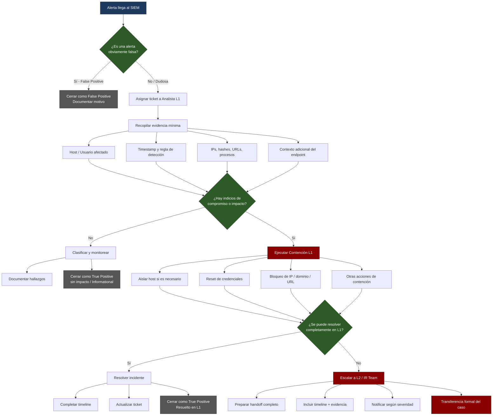

# 01 - Metodología de Respuesta a Incidentes

Este documento describe la metodología de **Respuesta a Incidentes (Incident Response - IR)** que se aplica en este laboratorio y que un Analista SOC L1 debe conocer y seguir.

La metodología se basa principalmente en:
- **NIST SP 800-61 Rev. 2** – Computer Security Incident Handling Guide
- **SANS PICERL** (Preparation, Identification, Containment, Eradication, Recovery, Lessons Learned)

---

## 1. Ciclo de Vida de un Incidente (PICERL / NIST)

| Fase | Nombre | Responsabilidad principal del L1 | Descripción breve |
|------|--------|----------------------------------|-------------------|
| 1 | **Preparation** | Conocer playbooks y herramientas | Preparación previa: playbooks, herramientas, accesos, contactos |
| 2 | **Identification** | **Principal** | Detección, triaje, validación y clasificación de la alerta |
| 3 | **Containment** | **Principal (inicial)** | Contención a corto plazo para limitar el daño |
| 4 | **Eradication** | Apoyo / Escalamiento | Eliminación de la amenaza (normalmente L2/IR) |
| 5 | **Recovery** | Apoyo | Restauración de sistemas a operación normal |
| 6 | **Lessons Learned** | Participación | Análisis post-incidente y mejoras |

> **Rol del Analista L1**: Se centra principalmente en las fases de **Identification** y **Containment** inicial. El resto se realiza en coordinación o bajo dirección de L2 / Incident Response Team.

---

## 2. Objetivos del Triaje (Identification)

El objetivo principal del triaje es responder estas preguntas lo más rápido posible:

1. ¿La alerta es real o es un falso positivo?
2. ¿Cuál es la severidad real del evento?
3. ¿Hay evidencia de compromiso (compromiso confirmado)?
4. ¿Qué sistemas/usuarios están afectados?
5. ¿Se puede contener desde L1 o se debe escalar?

### SLA de Triaje recomendados (ejemplos)

| Severidad | Tiempo máximo de triaje | Ejemplo |
|-----------|--------------------------|---------|
| Crítica   | ≤ 5 minutos              | Ransomware, C2 activo |
| Alta      | ≤ 15 minutos             | Credenciales comprometidas, phishing exitoso |
| Media     | ≤ 30 minutos             | Tráfico anómalo, alertas de malware no ejecutado |
| Baja      | ≤ 1 hora                 | Alertas informativas, posibles FPs |

---

## 3. Principios clave que debe seguir el Analista L1

1. **No asumir** – Siempre validar la alerta antes de actuar.
2. **Preservar evidencia** – No borrar logs, no apagar equipos sin necesidad, documentar todo.
3. **Contener primero, investigar después** (cuando hay impacto real).
4. **Documentar en tiempo real** – El timeline es crítico para el handoff.
5. **Escalar temprano** – Mejor escalar de más que de menos cuando hay duda de compromiso.
6. **Seguir el playbook** – Los playbooks existen para reducir errores bajo presión.

---

## 4. Flujo General de Trabajo del Analista L1

