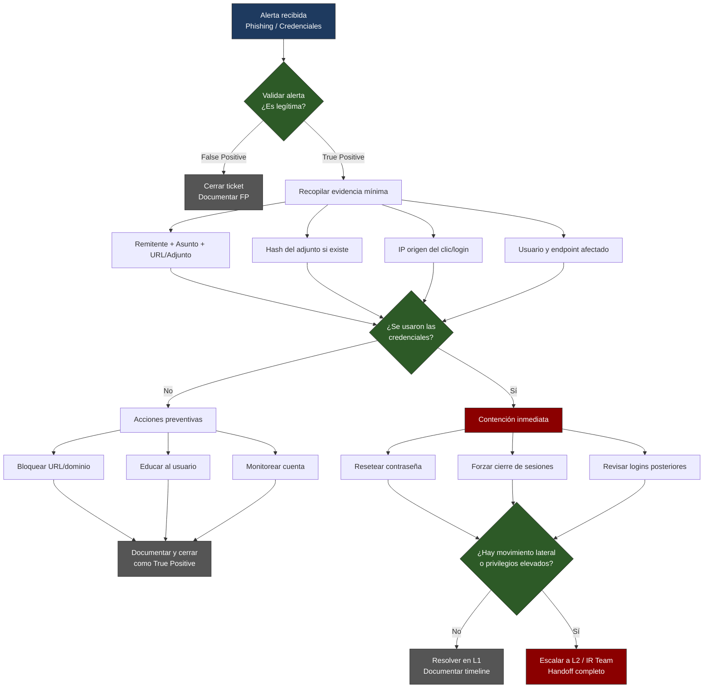

# PB-01: Phishing con Credenciales Comprometidas

**Nivel:** SOC L1  
**Severidad típica:** Media → Alta  
**Tiempo objetivo de triaje (SLA):** ≤ 15 minutos  
**MITRE ATT&CK:**
- T1566 – Phishing
- T1566.001 – Spearphishing Attachment
- T1566.002 – Spearphishing Link
- T1078 – Valid Accounts
- T1110 – Brute Force (si hay intentos posteriores)

## 1. Detección / Trigger
- Alerta Wazuh: “Possible phishing email” o “Suspicious URL clicked”
- Usuario reporta correo sospechoso
- Alerta de login desde ubicación inusual + correo previo

## 2. Triaje Inicial (L1)

1. **Validar la alerta**
   - Abrir el evento en Wazuh Dashboard
   - Revisar: usuario afectado, IP origen, hora, agente
   - Confirmar si el correo existe en el buzón (si tienes acceso a logs de correo)

2. **Recopilar evidencia mínima**
   - Remitente, asunto, URL/adjunto
   - Hash del adjunto (si existe)
   - IP de origen del clic/login
   - Agente Wazuh del endpoint afectado

3. **Determinar alcance**
   - ¿Solo un usuario o varios?
   - ¿Se usaron las credenciales? (login exitoso posterior)

## 3. Acciones Inmediatas (Contención L1)

| Acción | Herramienta | Responsable | Notas |
|--------|-------------|-------------|-------|
| Resetear contraseña del usuario | AD / Azure AD / local | L1 o solicitar a IAM | Obligatorio si hay evidencia de uso |
| Forzar cierre de sesiones | Azure AD / AD | L1 | |
| Bloquear URL/dominio en proxy/firewall | Firewall / Proxy | L1 (si tiene permisos) o escalar | |
| Aislar endpoint (si hay actividad post-login) | Wazuh Active Response / EDR | L1 | Solo si hay indicios de compromiso |

## 4. Documentación obligatoria
Usar la plantilla de ticket (templates/ticket-incident-response.md)

## 5. Criterios de Escalamiento a L2/L3
- Credenciales usadas con privilegios elevados
- Movimiento lateral detectado
- Más de 3 usuarios afectados
- Evidencia de malware post-phishing

## 6. Diagrama de flujo

## 7. Cierre
- Confirmar que el usuario puede acceder con nueva contraseña
- Actualizar ticket con timeline
- Etiquetar alerta como True Positive / False Positive