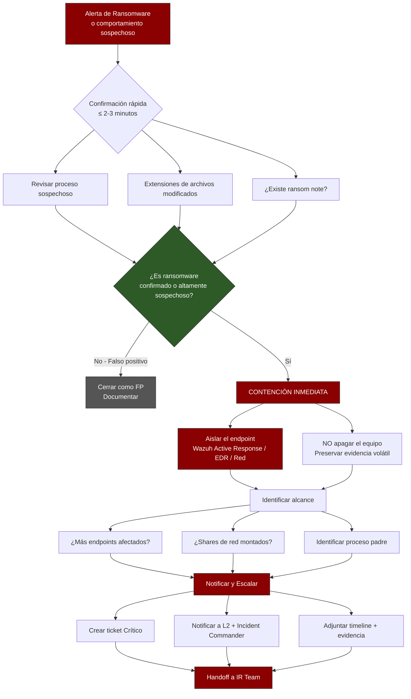

# PB-02: Alerta de Ransomware en Endpoint

**Nivel:** SOC L1  
**Severidad:** Crítica  
**SLA triaje:** ≤ 5 minutos  
**MITRE ATT&CK:**
- T1486 – Data Encrypted for Impact
- T1490 – Inhibit System Recovery
- T1083 – File and Directory Discovery
- T1059 – Command and Scripting Interpreter

## 1. Detección / Trigger
- Regla Wazuh: “Ransomware behavior detected”, “Multiple file modifications”, “Suspicious process creating .encrypted files”
- Alerta de File Integrity Monitoring (FIM) masiva
- Usuario reporta archivos bloqueados / mensaje de rescate

## 2. Triaje Inicial (L1) – ACCIONES RÁPIDAS

1. **Confirmar la alerta** (máximo 2-3 minutos)
   - Ver proceso sospechoso en Wazuh
   - Revisar extensiones de archivos modificados
   - Verificar si hay mensaje de ransom note

2. **Contención inmediata (prioridad #1)**
   - **Aislar el endpoint** → Wazuh Active Response o desconectar de red
   - No apagar el equipo (preservar memoria volátil si es posible)

3. **Identificar alcance**
   - ¿Hay más endpoints con la misma alerta?
   - ¿Hay shares de red montados?

## 3. Acciones L1

| Acción | Prioridad | Herramienta |
|--------|-----------|-------------|
| Aislar host | Crítica | Wazuh Active Response / EDR / switch |
| Identificar proceso padre | Alta | Wazuh / Sysmon |
| Recopilar ransom note (si existe) | Alta | Acceso remoto controlado |
| Verificar backups (no restaurar aún) | Media | Solicitar a Infrastructure |
| Notificar a L2 e Incident Commander | Crítica | Ticket + llamada |

## 4. Diagrama de flujo

## 5. Escalamiento inmediato
Siempre escalar a L2/IR Team en casos de ransomware confirmado o altamente sospechoso.

## 6. Documentación
Usar plantilla de ticket + checklist de ransomware.