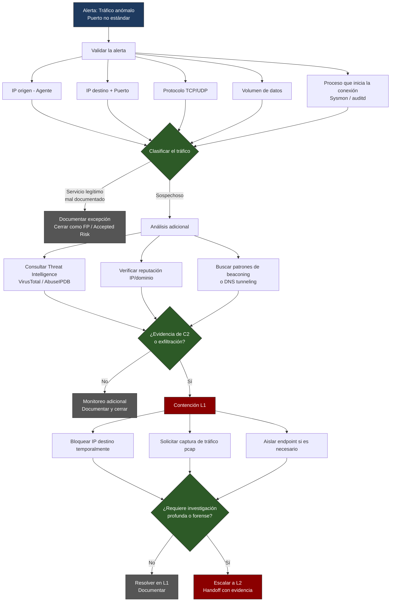

# PB-03: Tráfico Anómalo hacia Puerto No Estándar

**Nivel:** SOC L1  
**Severidad:** Baja → Media  
**SLA triaje:** ≤ 20 minutos  
**MITRE ATT&CK:**
- T1048 – Exfiltration Over Alternative Protocol
- T1071 – Application Layer Protocol
- T1571 – Non-Standard Port
- T1090 – Proxy

## 1. Detección
- Alerta Wazuh: “Connection to non-standard port”, “Suspicious outbound connection”
- Reglas de firewall / Suricata / Zeek
- Netflow anómalo

## 2. Triaje

1. Validar:
   - IP origen (agente)
   - IP destino + puerto
   - Protocolo (TCP/UDP)
   - Volumen de datos
   - Proceso que inicia la conexión (Sysmon / auditd)

2. Clasificar:
   - ¿Es un servicio legítimo mal documentado?
   - ¿Es C2 conocido? (consultar Threat Intel)
   - ¿Hay DNS tunneling o beaconing?

## Diagrama de flujo

## 3. Acciones

- Bloquear IP destino temporalmente (si es claramente maliciosa)
- Solicitar captura de tráfico (pcap) al endpoint
- Verificar reputación de IP/dominio (VirusTotal, AbuseIPDB, etc.)
- Escalar si hay evidencia de exfiltración o C2 confirmado